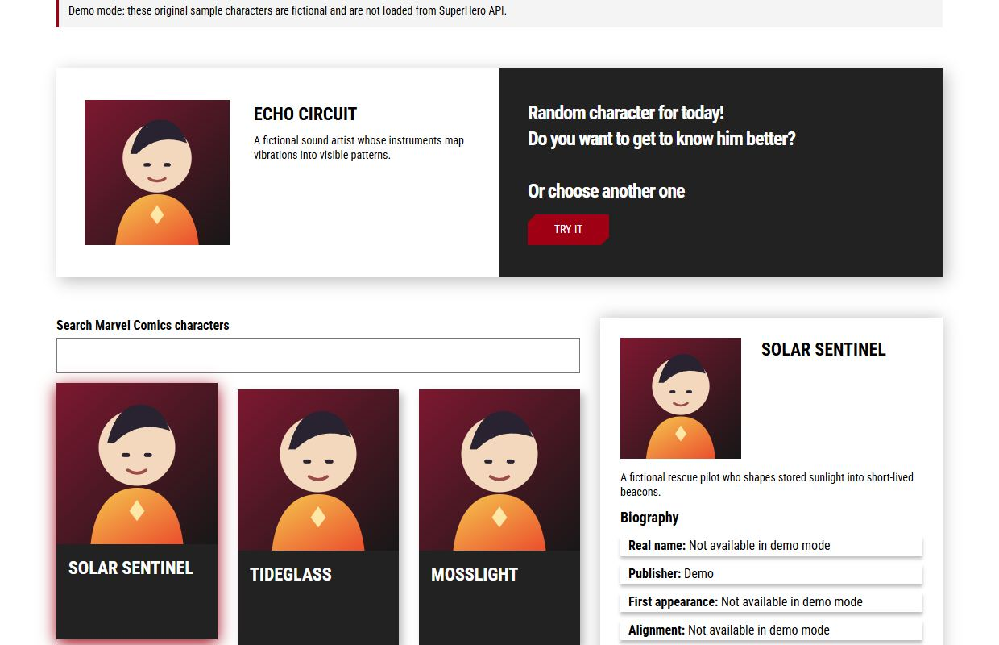
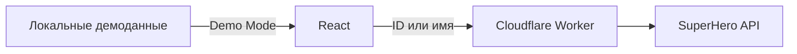

<div align="center">

# 🦸 Marvel Character Explorer

**Каталог персонажей Marvel с поиском по имени, портретами, биографиями и характеристиками.**

   

[Открыть каталог](https://goldlexx.github.io/marvel/) · [Открыть деморежим](https://goldlexx.github.io/marvel/?demo=true) · [Локальный запуск](#локальный-запуск)

</div>

## Как пользоваться

Главная показывает персонажей из подборки из 12 ID, порциями по шесть. Выберите карточку, чтобы посмотреть настоящее имя героя, первое появление, происхождение, псевдонимы и доступные характеристики. Набор сведений зависит от записи в SuperHero API.

Поиск обращается к сервису по имени. В результатах остаются записи с издателем `Marvel Comics`, поэтому поиск может вернуть больше героев, чем представлено в стартовой подборке.



*На снимке включён Demo Mode. Персонажи этого набора вымышлены, портреты загружаются локально.*

## Откуда берутся данные



| Технология | Что делает в проекте |
| --- | --- |
| React и Sass | Список, выбор карточки, детали героя и состояния загрузки |
| Vite и Vitest | Разработка, сборка и проверки компонентов и сервиса |
| Cloudflare Workers | Два маршрута GET с CORS для опубликованного frontend |
| SuperHero API | Биография, характеристики и URL портрета |

[Сервис персонажей](src/services/MarvelService.js) нормализует ответы, хранит уже загруженные профили в памяти и прерывает затянувшийся запрос через 12 секунд. Отсутствующие поля получают текстовую замену. Адрес изображения берётся из ответа API. Если портрета нет или он не загрузился, [компонент изображения](src/components/characterImage/CharacterImage.jsx) показывает локальную SVG-иллюстрацию. [Worker](worker/index.js) принимает только `/api/characters/:id` и `/api/search/:name`. Ключ `SUPERHERO_API_TOKEN` нужен на стороне Worker.

## Локальный запуск

```sh
npm ci
npm start
```

Откройте выведенный Vite адрес с параметром `?demo=true`. Можно также задать `VITE_MARVEL_DEMO_MODE=true` в `.env.local`. [Локальный набор](src/services/demoCharacters.js) позволяет проверить выбор карточки и поиск при недоступности внешнего API.

Публичный Worker разрешает запросы со страницы на GitHub Pages. Для другого окружения используйте совместимый прокси и укажите его базовый URL вместе с `/api` в `VITE_SUPERHERO_API_PROXY_URL`.

## Проверки

`npm test` запускает Vitest для обработки ответов, фильтрации и выбора карточек. `npm run build` собирает статическую версию.
